<p align="center">
  
</p>

<div align="center">

**Live site:** <https://zgdccaspamchapter.vercel.app/>

The official website of the Zakariyan Google Developer Club (ZGDC) chapter at Bahauddin Zakariya University, Multan.


</div>

<p align="center">
  <a href="https://zgdccaspamchapter.vercel.app/"></a>
</p>

---

## What is on the site

| Page | Route | What it does |
| --- | --- | --- |
| **Home** | `#/home` | Animated intro, 3D hero and the chapter's learning tracks |
| **About Us** | `#/about` | Who we are, what we do |
| **Members** | `#/members` | Team and member profiles (from `team.json`) |
| **Events** | `#/events` | Upcoming and past events, registration form |
| **Notes** | `#/notes` | Learning library: notes, slides and files shared after sessions |
| **Contact Us** | `#/contact` | Contact form and chapter details |

The site uses hash routes, so no server setup is needed. Pages are wired in `src/App.jsx` and `src/components/Navbar.jsx`.

## Screenshots

Phone view of every page:

<table>
  <tr>
    <td align="center">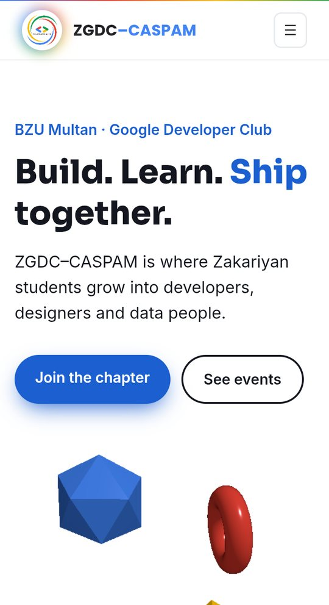<br /><sub><b>Home</b></sub></td>
    <td align="center">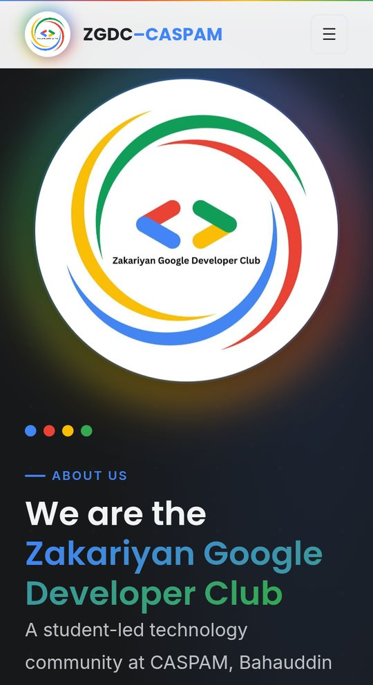<br /><sub><b>About Us</b></sub></td>
    <td align="center">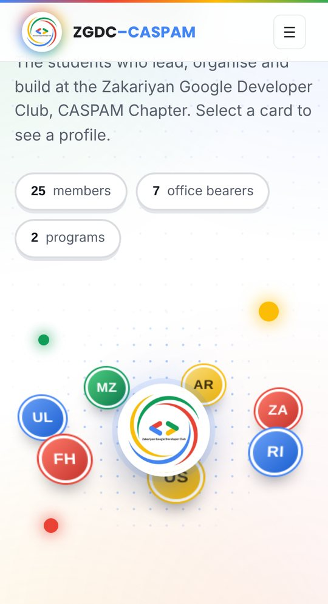<br /><sub><b>Members</b></sub></td>
  </tr>
  <tr>
    <td align="center">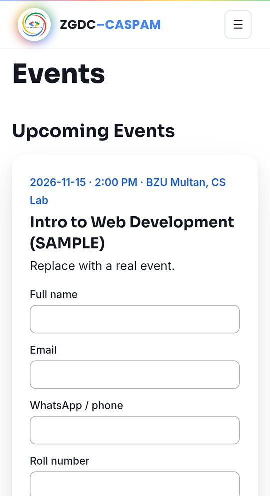<br /><sub><b>Events</b></sub></td>
    <td align="center">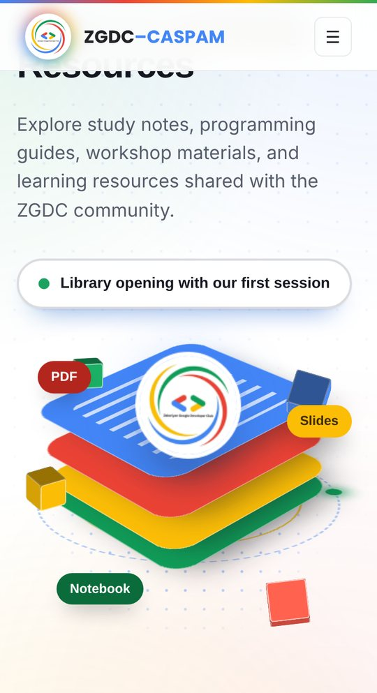<br /><sub><b>Notes</b></sub></td>
    <td align="center">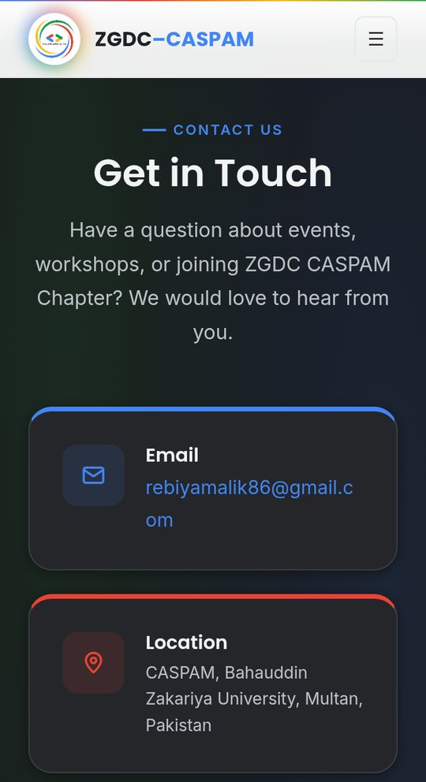<br /><sub><b>Contact Us</b></sub></td>
  </tr>
</table>

Desktop view:

<p align="center">
  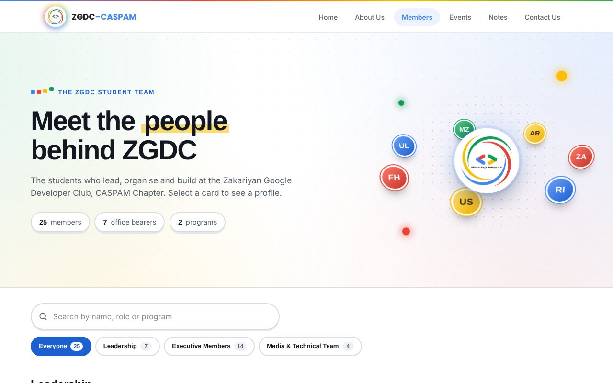
  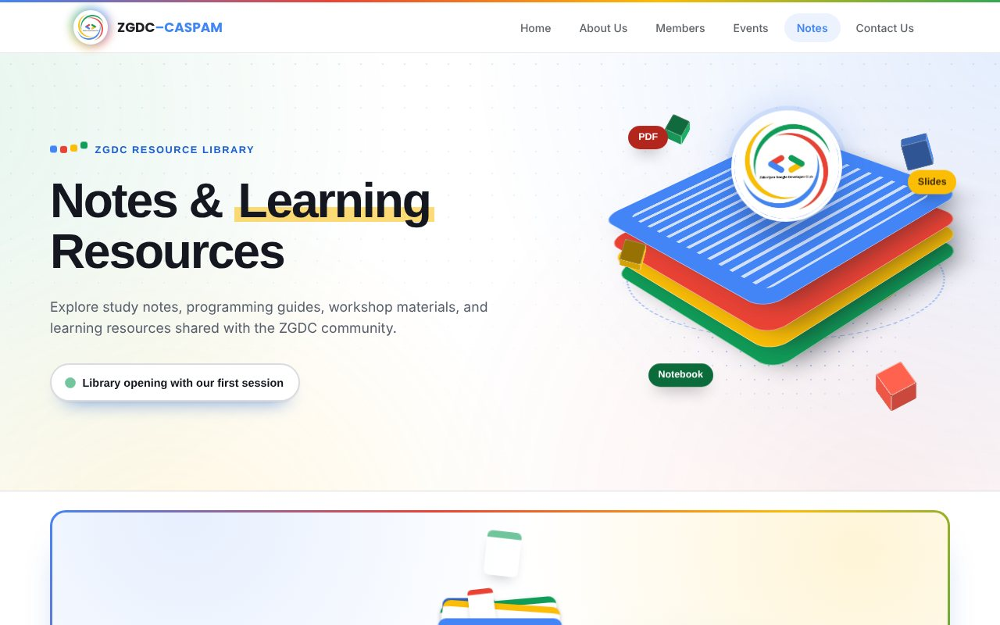
</p>

<details>
<summary>See the full Members and Notes pages</summary>

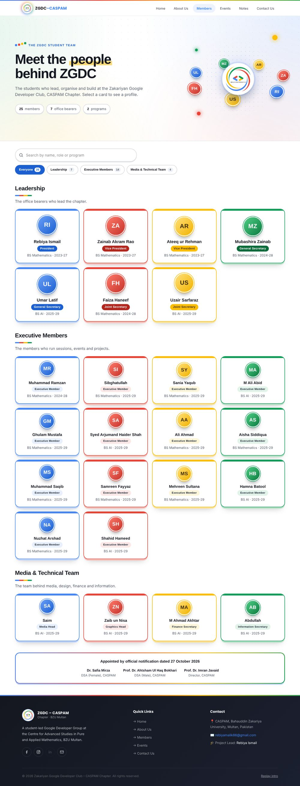

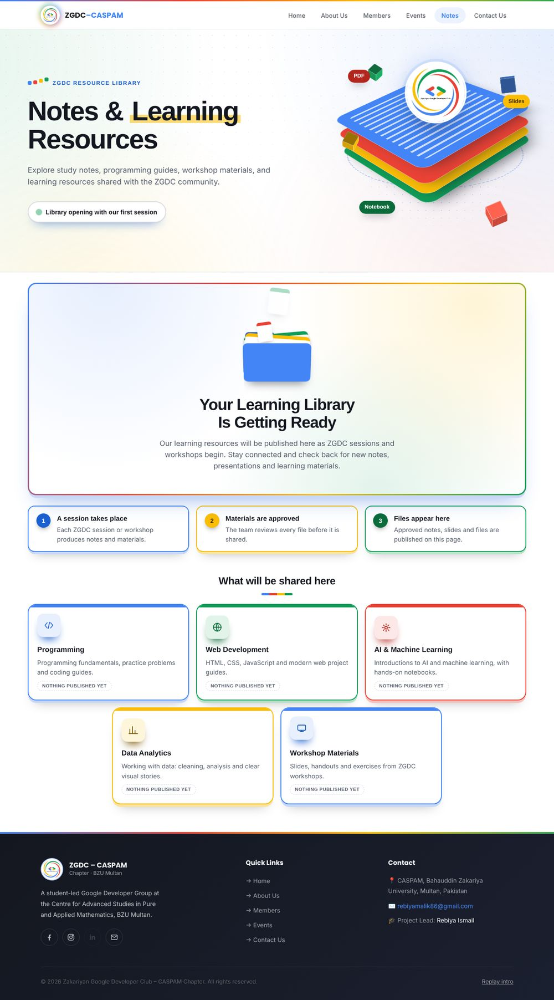

</details>

## Quick start

```bash
npm install
npm run dev      # http://localhost:5173
npm run build    # production build in /dist
```

## Folder structure

```text
public/                  logo, banner and static files
  notes/                 PDFs shared on the Notes page and Events
src/
  pages/                 Home, About, Members, Events, Notes, Contact
  components/            Intro, Navbar, Hero, Scene3D, Tracks, Footer, Logo
    notes/               building blocks of the Notes page
  data/
    team.json            members
    events.json          events
    site.json            contact details and social links
    resources.js         the Notes library (see below)
  lib/notesPublishing.js rules that decide which resources are shown
  hooks/useTilt.js       hover tilt
  index.css              brand colours (CSS variables) + global styles
firestore.rules          database security rules
screenshots/             images shown in this README
```

## Edit content (no coding needed for most of it)

- **Members:** add an object to `src/data/team.json` (`name`, `role`, `bio`, `skills`, `links`, `photo`). The photo is saved in `public/team/` (for example `/team/ayesha.jpg`), square and under 200 KB.
- **Events:** add to `src/data/events.json`. `status` is `upcoming` or `past`. For registration, set `registerUrl` (Google Form), or leave it empty to use the built-in form. Notes for an event: put the PDF in `public/notes/` and list it in `notes` (`{ "title": "Slides", "file": "/notes/web-day1.pdf" }`).
- **Site-wide:** `src/data/site.json` (contact email, address, social links, and an optional `formEndpoint` for Formspree or Apps Script so registrations and contact messages do not rely on email).
- **Text:** `src/pages/About.jsx` (search for `TODO`).

## Notes & Learning Resources page

The Notes page shows learning material after each ZGDC session. A resource appears only when it is **approved** and **complete**. Until the first one is added, the page shows a "Your Learning Library Is Getting Ready" state.

**Add a resource after a session**

1. Upload the file (for example a PDF) to `public/notes/`. Use a simple name with no spaces, such as `python-session-1.pdf`.
2. Open `src/data/resources.js` and add an entry to the `resources` list:

```js
{
  id: 1,                                    // unique number, never reuse one
  title: "Python Session 1 Notes",
  description: "Short summary of the session.",
  category: "Programming",                  // must be one of CATEGORIES in the same file
  topic: "Python",
  fileType: "PDF",                          // "PDF", "Slides", "Notebook" or "Link"
  session: "Session 1",                     // optional
  addedOn: "2026-11-06",                    // YYYY-MM-DD
  approved: true,                           // set to true only after a lead approves it
  resourceUrl: file("python-session-1.pdf"),
  downloadUrl: file("python-session-1.pdf"),
},
```

3. Commit. The card appears after the next deploy.

**Good to know**

- The name inside `file("...")` must match the uploaded file exactly, including capital letters.
- For something stored elsewhere (for example Google Drive), use the full web address: `resourceUrl: "https://..."`.
- A resource is hidden if `approved` is not exactly `true`, a link is missing or invalid, or the category, file type or date is wrong. While developing (`npm run dev`) the browser console says why an entry is hidden.
- Categories live in `CATEGORIES` in `src/data/resources.js`. Add a name there to create a new filter.

## Swap the logo and colours

1. Replace `public/logo.png` (transparent PNG). The round logo used in the navbar and on the Notes page is `public/zgdc-logo.jpg`.
2. Update the `--brand-*` variables in `src/index.css`. `--brand-main` is a darker blue used for text and buttons so contrast stays above 4.5:1.

## Git workflow (15 people)

- `main` = production (auto-deploys). Protect it; no direct pushes.
- `dev` = integration branch.
- Each person: `git checkout -b feature/<name>-<task>` from `dev`, commit small, open a PR into `dev`, and get 1 review.
- The lead merges `dev` → `main` for releases. Content-only edits (JSON) use `content/<name>` branches.

## Deploy on Vercel

1. Push to GitHub.
2. vercel.com → Add New → Project → import the repo.
3. Framework preset: Vite. Build command `npm run build`, output `dist`. Deploy.
4. Every PR gets a preview URL; merges to `main` go live.

## Free database (Firebase Firestore)

Event registrations and contact messages are saved to Firestore (free Spark plan, no card needed). Until it is configured, the forms fall back to email.

**Setup (one person, about 10 minutes)**

1. console.firebase.google.com → Add project (disable Analytics).
2. Build → Firestore Database → Create database → production mode → region closest to Pakistan (for example `asia-south1`).
3. Project settings → Your apps → Web (`</>`) → register app → copy the config values.
4. Copy `.env.example` to `.env` and paste the 4 values. Never commit `.env`.
5. Firestore → Rules tab → paste the contents of `firestore.rules` → Publish. This lets visitors only *create* validated records; nobody can read or delete from the website.
6. Vercel → Project → Settings → Environment Variables → add the same 4 `VITE_FIREBASE_*` values → redeploy.

**Reading the data:** Firebase console → Firestore → `registrations` / `messages`. Only members added under Project settings → Users and permissions can see it. Copy or export from there (exports need the paid plan; for CSV, a lead can copy rows or use a Google Sheet via Apps Script later).

**Free limits (Spark):** 1 GiB storage, 50k reads and 20k writes per day, which is plenty for a club.

**Collaborators on the database:** add teammates in Firebase console → Project settings → Users and permissions (Editor/Viewer). Share config through the team's private channel, not the repo.

> The Firebase web config is not a secret (it only identifies the project). The security comes from `firestore.rules`.

---

<div align="center">

Made with care by the ZGDC–CASPAM team · Bahauddin Zakariya University, Multan

</div>
