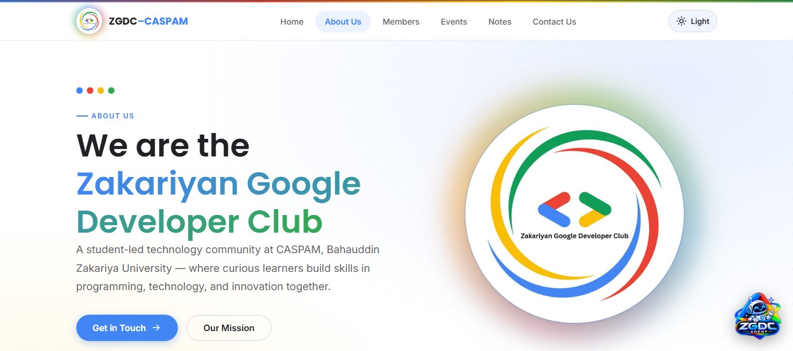
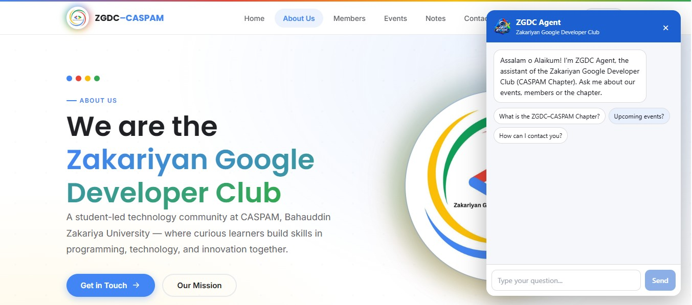

# 🚀 ZGDC–CASPAM Chapter Website

**Zakariyan Google Developer Club – CASPAM Chapter**
Center for Advanced Studies in Pure and Applied Mathematics (CASPAM)
Bahauddin Zakariya University, Multan, Pakistan

[](https://zgdccaspamchapter.vercel.app/)
[](https://github.com/rebiyamalik/ZGDC-CASPAM-Chapter)


---

## 📋 Pages

| Page | Route | Description |
|------|-------|-------------|
| Home | `#/home` | Hero, stats (25 Members), AI Baithak event, FAQ |
| About Us | `#/about` | Introduction, mission, vision, objectives |
| Members | `#/members` | Team profiles and member cards |
| Events | `#/events` | AI Baithak (upcoming) + future events + registration |
| Notes | `#/notes` | Learning resources library by topic |
| Contact Us | `#/contact` | Contact form, social links, LinkedIn |

---

## 🎨 Design System

- **Theme:** Light (white background `#FFFFFF`) — no dark mode
- **Primary Blue:** `#4285F4`
- **Red:** `#EA4335`
- **Yellow:** `#FBBC05`
- **Green:** `#34A853`
- **Text:** `#202124` / `#5F6368`
- **Footer:** `#202124` (near black)
- **Fonts:** Inter (body), Poppins (headings), Sora (display)
- **Icons:** Custom inline SVG set (no external icon library)

---

## 🛠️ Tech Stack

| Area | Tool |
|------|------|
| Frontend | React 18 + Vite |
| Styling | Tailwind CSS + custom CSS design tokens |
| Animation | GSAP + CSS animations |
| 3D | Three.js (hero section only) |
| Database | Firebase Firestore (free Spark plan) |
| Deployment | Vercel (auto-deploy from GitHub) |

</details>
ZGDC Agent, the AI assistant:

<p align="center">
  
  
</p>


## ⚙️ Local Development

```bash
# 1. Clone the repository
git clone https://github.com/rebiyamalik/ZGDC-CASPAM-Chapter.git
cd ZGDC-CASPAM-Chapter

# 2. Install dependencies
npm install

# 3. Set up environment variables
# Copy .env.example to .env and fill in Firebase values
copy .env.example .env

# 4. Start development server
npm run dev

# 5. Open in browser
# http://localhost:5173
```

---

## 📁 Folder Structure

```text
public/                  Logo, static files, PDFs
  zgdc-logo.jpg          Club logo
  notes/                 PDF notes shared after sessions
src/
  pages/                 Home, About, Members, Events, Notes, Contact
  components/            Navbar, Hero, Scene3D, Tracks, Footer, Icons, SocialLinks
    notes/               Notes page building blocks (by Ramzan)
  data/
    team.json            Members list
    events.json          Events (AI Baithak + future)
    resources.js         Notes library — add entries here after each session
    zgdcInfo.js          Single source of truth for club details
    site.json            Contact details and social links
  styles/                About.css, Contact.css, zgdc-shared.css
  lib/
    db.js                Firebase Firestore helpers (saveDoc, registerForEvent)
    notesPublishing.js   Rules for which resources are shown
  index.css              Design tokens (CSS variables) + global styles
  App.jsx                Router and page switching
hooks/
  useRoute.js            Hash-based routing
  useTilt.js             Hover tilt effect
.env.example             Firebase config template (never commit .env)
firestore.rules          Database security rules
```

---

## 📝 Updating Content

### Add/update club info (email, address, social links)
```
src/data/zgdcInfo.js
```

### Add an event
```
src/data/events.json
```
Set `"status": "upcoming"` or `"status": "past"`.

### Add a learning resource (after a session)
1. Put the PDF in `public/notes/` (e.g. `python-session-1.pdf`)
2. Open `src/data/resources.js` and add an entry:
```js
{
  id: 1,
  title: "Python Basics – Session 1",
  description: "Short summary of the session.",
  category: "Programming",   // must match a name in CATEGORIES
  topic: "Python",
  fileType: "PDF",           // "PDF" | "Slides" | "Notebook" | "Link"
  session: "Session 1",
  addedOn: "2026-11-06",     // YYYY-MM-DD
  approved: true,            // only after a lead approves it
  resourceUrl: file("python-session-1.pdf"),
  downloadUrl: file("python-session-1.pdf"),
},
```

### Add member photos
Add photos to `public/team/` (square, under 200 KB) and update:
```
src/data/team.json
```

### Environment variables (Firebase)
Copy `.env.example` to `.env` and fill in your Firebase values.
**Never commit `.env` to GitHub.**

---

## 🔥 Firebase Setup (Free Tier)

1. Go to [console.firebase.google.com](https://console.firebase.google.com) → Add project
2. Build → Firestore Database → Create database → Production mode → region `asia-south1`
3. Project Settings → Your apps → Web → Register → copy config values
4. Paste values into `.env`
5. Firestore → Rules → paste contents of `firestore.rules` → Publish
6. Vercel → Project → Settings → Environment Variables → add same `VITE_FIREBASE_*` values → redeploy

---

## 🚀 Deployment (Vercel)

1. Push code to the `main` branch on GitHub
2. Vercel auto-deploys on every push
3. Add environment variables: Vercel → Project → Settings → Environment Variables

---

## 🔗 Official Links

- 🌐 [Website](https://zgdccaspamchapter.vercel.app/)
- 💼 [LinkedIn](https://www.linkedin.com/company/zakariyan-google-developer-club-caspam-chapter)
- 📷 [Instagram](https://www.instagram.com/zgdc_caspam_chapter)
- 👥 [Facebook](https://www.facebook.com/zgdccaspam)
- 📧 rebiyamalik86@gmail.com

---

## 🌿 Git Workflow

- `main` = production branch (auto-deploys to Vercel)
- Each member: `git checkout -b feat/<name>-<task>` from `main`
- Commit small and often: `feat: add events cards` / `fix: validate email`
- Open a Pull Request → get reviewed → merge to `main`
- **Never commit `.env` or API keys**

---

*Built with ❤️ by the ZGDC–CASPAM team · BZU Multan · 2026*
